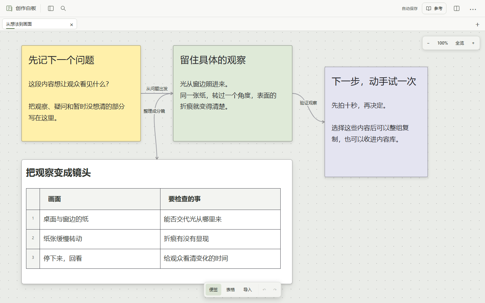
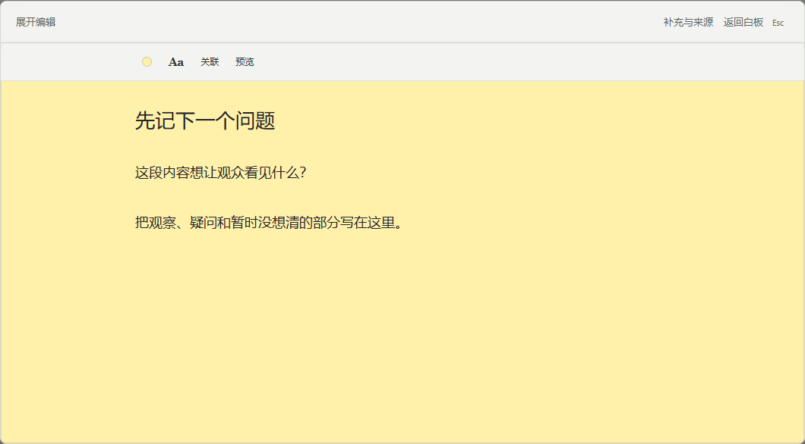
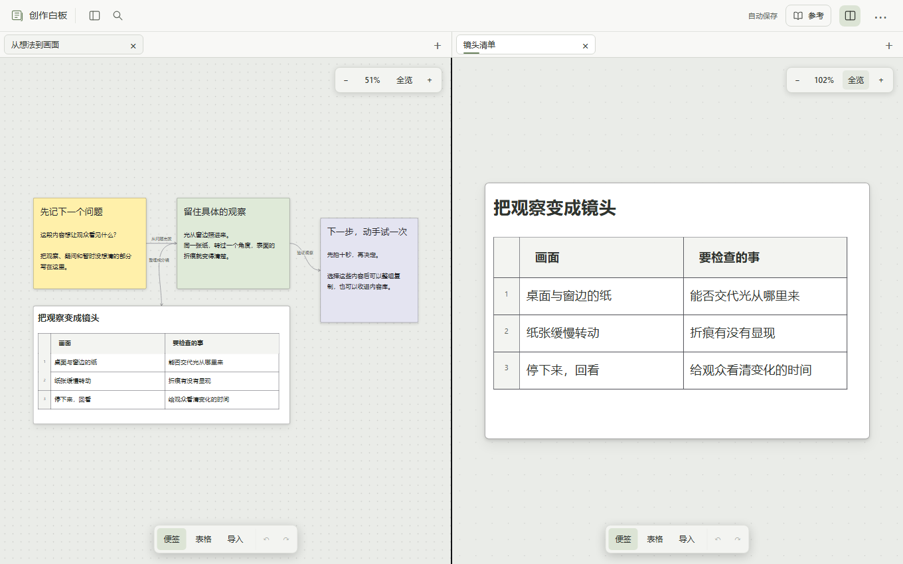

# 创作白板

**把笔记、资料和表格放在一起，慢慢整理出自己的思路。**

先记下一点，再移动、连接和编排。用浏览器打开，内容保存在自己的电脑里。

[三步开始](#三步开始) · [使用说明](docs/usage.md) · [版本与进度](docs/status.md) · [English](#english)

<picture>
  <source media="(prefers-color-scheme: dark)" srcset="docs/screenshots/canvas-dark.png">
  
</picture>

<sub>原工作台截图，使用仓库自带的示例白板；浅色为“纸白”，深色为“深灰”。</sub>

## 从零散想法，到可以继续的工作

- **先记下来。** 双击空白处写便签。新便签随文字增高，也可以手动定下大小。
- **把资料放在旁边。** 图片、音视频、表格、本地 HTML 和 JSON 可以和文字一起摆放，用连线说明关系。
- **按自己的方式整理。** 自由移动、分组，或把内容放进表格。常用内容收进内容库，下次取出副本继续用。
- **接着上次做。** 长文展开写，两张白板并排看。自动保存，遇到保存失败或冲突时保留当前内容并提示处理。

<details>
<summary><strong>写长一点：展开原便签继续编辑</strong></summary>

文字、补充与备注仍属于原便签；返回后继续在白板上编排。



</details>

<details>
<summary><strong>并排查看：一边看资料，一边整理</strong></summary>

标签页保存打开的白板，左右分栏可以调整宽度。窄窗口集中显示当前一侧，再从标签切换。



</details>

## 三步开始

需要 **Python 3.10 或更新版本**，以及 Chrome 或 Edge。运行应用无需安装 npm 或 Python 第三方依赖。

**1. 下载项目。** [下载 ZIP](https://github.com/Yueyue673/creative-whiteboard/archive/refs/heads/main.zip) 并解压，或者：

```sh
git clone https://github.com/Yueyue673/creative-whiteboard.git
cd creative-whiteboard
```

**2. 在项目目录启动。**

```sh
python server.py
```

如果系统使用 `python3`，改为 `python3 server.py`。使用时保留这个终端窗口。

**3. 打开白板，写第一条。** 在浏览器访问 [http://127.0.0.1:18746/](http://127.0.0.1:18746/)，双击画布空白处开始写。也可以把 [示例白板](examples/getting-started.json) 下载后拖入画布，试着移动、编辑和连接。

## 用得上的几个操作

| 想做什么 | 怎么做 |
| --- | --- |
| 新建、编辑便签 | 双击空白处、双击便签 |
| 移动画布 | 按住右键或中键拖动 |
| 放大、缩小 | Ctrl＋滚轮 |
| 连接内容 | 从选中内容边缘的圆点拖向另一块 |
| 撤销、搜索 | Ctrl＋Z、Ctrl＋K |
| 回看全局 | Shift＋1 |

更多操作见 [使用说明](docs/usage.md)：[资料阅读](docs/usage.md#资料阅读)、[标签与分栏](docs/usage.md#标签页与左右分栏)、[外观与大小](docs/usage.md#怎样调整显示大小)、[删除与找回](docs/usage.md#删除与找回)。

## 保存在哪里，哪些事情需要留意

默认保存在本机 `data/` 文件夹。备份时复制该文件夹；引用在其他目录的原文件需要一起备份。历史记录可以帮助恢复误操作，不能代替独立备份。[文件位置与配置](docs/usage.md#文件位置与配置)

本机版没有远程访问鉴权，请勿直接开放到公网。多个窗口可以分别工作、跨白板复制；同时修改同一张白板仍需处理保存冲突。当前浏览器的外观与阅读位置暂不跨设备同步。

AI 入口用于整理研究任务和核对有来源的参考资料，工具不调用模型或自动上传内容，也不代写、改写你的正文。[AI 协作说明](docs/ai-workflow.md)

**默认分支提供本机版。** 账号、工作区与托管服务在开发分支中集成；草稿和资料对照实验不能视为默认版已发布功能。[查看版本区别与进度](docs/status.md)

## 反馈与参与

发现操作问题，欢迎 [提交 Issue](https://github.com/Yueyue673/creative-whiteboard/issues)，说明想完成的任务、操作步骤和实际结果。截图请去掉私人材料。开发与检查方法见 [参与开发](CONTRIBUTING.md)。

## English

Creative Whiteboard is a local-first canvas for notes, media and tables. Arrange ideas freely, connect related material, and return to your work in a browser. It runs with Python’s standard library; the interface and guides are currently in Chinese.

The default branch provides the local application. Hosted account and workspace support is under development; see [version status](docs/status.md). This is not a real-time collaborative editor.

---

[MIT License](LICENSE) · Bundled html2canvas: [MIT](vendor/html2canvas.LICENSE). Imported media keeps its original license.
