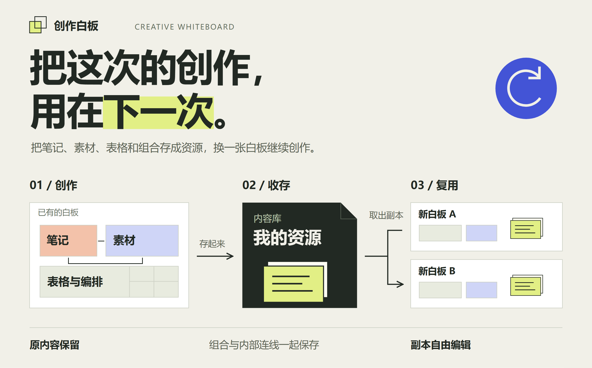

# 创作白板

**让做过的内容，成为下次创作的资源。**

[开始使用](#三步开始) · [看一次完整复用](docs/reuse.md) · [使用说明](docs/usage.md) · [English](#english)

<picture>
  <source media="(max-width: 640px)" srcset="docs/brand/reuse-cover-mobile.png">
  
</picture>

<sub>积累与复用的流程示意；下面展示原工作台的实际界面。</sub>

## 做过的内容，不必从头再做

在白板上写笔记、放资料、整理表格。值得留下的部分，可以存进**内容库**，成为自己积累的资源。

下一次创作，把它取到另一张白板，继续修改、连接和组合。一张便签可以复用，一整组内容连同内部连线也可以。

**01　选出要留下的内容**

在白板上多选便签、表格或组合，点底部的「保存到库」。原白板上的内容会保留。

**02　存成自己的资源**

给它起个名字，放进内容库。可以按文件夹整理，也可以搜索后再找回来。

**03　换张白板，接着用**

从内容库拖到新白板，得到可独立编辑的副本。也可以选中库中资源，按 **Ctrl＋Enter** 整体放入。


<sub>使用仓库自带的示例白板演示：同一组笔记、表格和连线，已经用于另一张白板。</sub>

### 原件留下，副本继续生长

白板上的改动不会自动覆盖库中原件。想把改好的部分带回去时，右键打开「来源与版本」，先比较，再决定更新哪一边；其他副本仍然独立。

[跟着做：收存 → 复用 → 回看来源](docs/reuse.md)

<details>
<summary><strong>除了复用，也能自由编排、展开写作、并排查看</strong></summary>

- **在同一张白板里整理。** 文字、图片、音视频、表格、本地 HTML 和 JSON 可以摆在一起，用连线说明关系。
- **把一条想法写长。** 展开原便签继续编辑，返回后保留在原来的位置。
- **把两张白板放在眼前。** 标签页与左右分栏用于对照资料；窄窗口集中显示当前一侧，再从标签切换。


</details>

## 三步开始

需要 **Python 3.10 或更新版本**，以及 Chrome 或 Edge。运行应用无需安装 npm 或 Python 第三方依赖。

**1. 下载项目。** [下载 ZIP](https://github.com/Yueyue673/creative-whiteboard/archive/refs/heads/main.zip) 并解压，或者：

```sh
git clone https://github.com/Yueyue673/creative-whiteboard.git
cd creative-whiteboard
```

**2. 在项目目录启动。**

```sh
python server.py
```

如果系统使用 `python3`，改为 `python3 server.py`。使用时保留这个终端窗口。

**3. 打开白板，写第一条。** 在浏览器访问 [http://127.0.0.1:18746/](http://127.0.0.1:18746/)，双击画布空白处开始写。也可以把 [示例白板](examples/getting-started.json) 下载后拖入画布，试着移动、编辑和连接。

## 用得上的几个操作

| 想做什么 | 怎么做 |
| --- | --- |
| 新建、编辑便签 | 双击空白处、双击便签 |
| 移动画布 | 按住右键或中键拖动 |
| 放大、缩小 | Ctrl＋滚轮 |
| 连接内容 | 从选中内容边缘的圆点拖向另一块 |
| 存成资源、再次使用 | 选中白板内容后 Ctrl＋Shift＋L；在内容库选中资源后 Ctrl＋Enter |
| 撤销、搜索 | Ctrl＋Z、Ctrl＋K |
| 回看全局 | Shift＋1 |

更多操作见 [使用说明](docs/usage.md)：[资料阅读](docs/usage.md#资料阅读)、[标签与分栏](docs/usage.md#标签页与左右分栏)、[外观与大小](docs/usage.md#怎样调整显示大小)、[删除与找回](docs/usage.md#删除与找回)。

## 保存在哪里，哪些事情需要留意

默认保存在本机 `data/` 文件夹。备份时复制该文件夹；引用在其他目录的原文件需要一起备份。历史记录可以帮助恢复误操作，不能代替独立备份。[文件位置与配置](docs/usage.md#文件位置与配置)

本机版没有远程访问鉴权，请勿直接开放到公网。多个窗口可以分别工作、跨白板复制；同时修改同一张白板仍需处理保存冲突。当前浏览器的外观与阅读位置暂不跨设备同步。

AI 入口用于整理研究任务和核对有来源的参考资料，工具不调用模型或自动上传内容，也不代写、改写你的正文。[AI 协作说明](docs/ai-workflow.md)

**默认分支提供本机版。** 账号、工作区与资料对照在开发分支中继续完善；已发布的开发版尚未合并到默认分支。[查看版本区别与进度](docs/status.md)

## 反馈与参与

发现操作问题，欢迎 [提交 Issue](https://github.com/Yueyue673/creative-whiteboard/issues)，说明想完成的任务、操作步骤和实际结果。截图请去掉私人材料。开发与检查方法见 [参与开发](CONTRIBUTING.md)。

## English

**Turn what you create into resources for your next project.**

Creative Whiteboard lets you save notes, tables, media and groups of content to your own library, then reuse them on another board. A saved group keeps its internal connections. Place an independent copy, adapt it to the new work, and compare it with the library original when you choose to update either side.

It is a local-first application that runs with Python’s standard library and opens in a browser. The interface and guides are currently in Chinese. [Start locally](#三步开始) · [Reuse walkthrough](docs/reuse.md)

The default branch provides the local application. Account/workspace support and additional source-reading workflows are available on the development branch; see [version status](docs/status.md). This is not a real-time collaborative editor.

---

[MIT License](LICENSE) · Bundled html2canvas: [MIT](vendor/html2canvas.LICENSE). Imported media keeps its original license.
