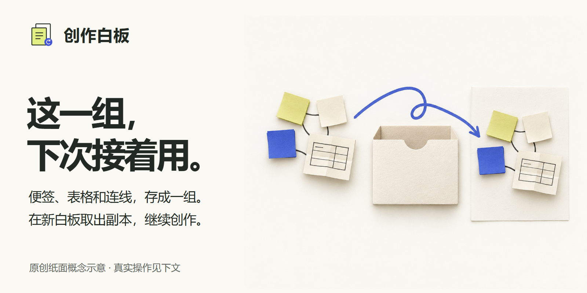
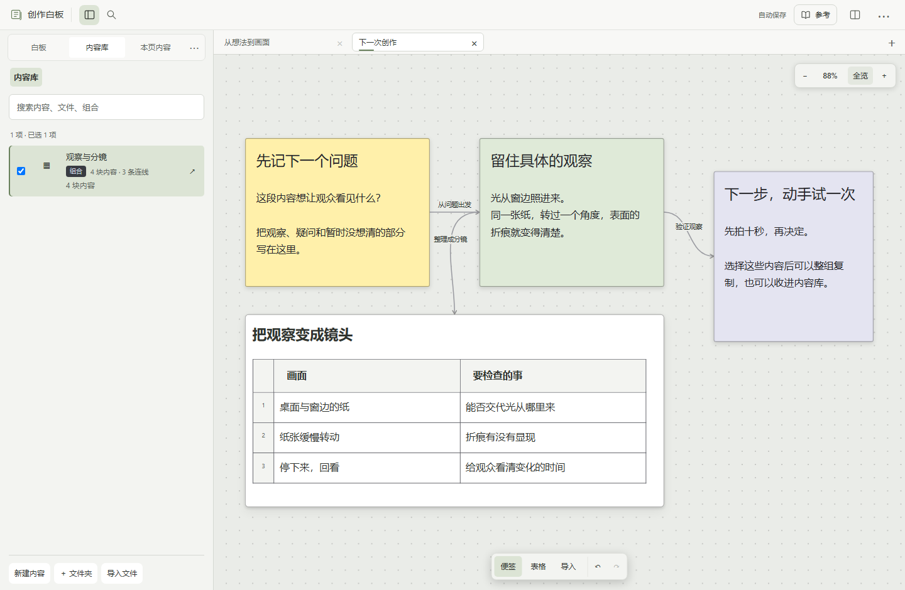
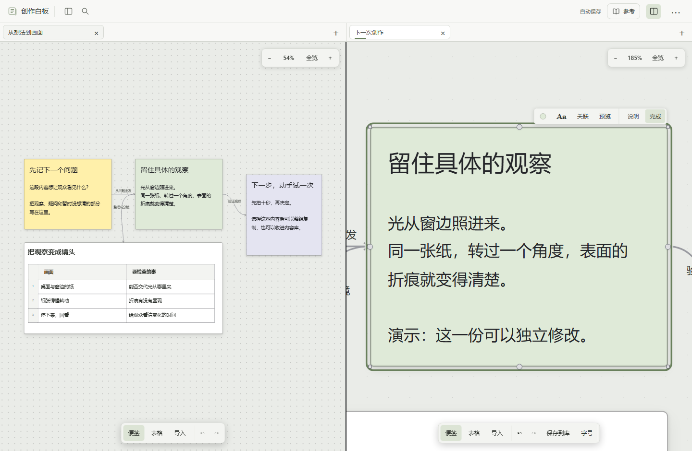

<p align="center">
  
</p>

<h1 align="center">创作白板</h1>

创作白板是在浏览器里使用的笔记和资料整理工具。把便签、图片、文件和表格放到同一张白板，移动位置、连起相关内容。整理好的一组内容可以存进**内容库**，下次取出副本继续用。下载后在自己的电脑上启动，需要 **Python 3.10 或更新版本**及 **Chrome / Edge**；本机版无需账号，内容默认保存在电脑上。

<p align="center">
  <a href="https://github.com/Yueyue673/creative-whiteboard/archive/refs/heads/main.zip"><strong>下载本机版</strong></a> ·
  <a href="#三步开始">三步开始</a> ·
  <a href="docs/usage.md">使用说明</a> ·
  <a href="docs/status.md">版本区别</a> ·
  <a href="docs/posters/README.md">介绍海报</a>
</p>



## 留下这一组，下次接着用

为一段画面记下问题、观察，再列一张镜头表。下次还想用这组结构，可以把它留下来。下面用仓库自带的「观察与分镜」演示示例走一遍：

1. 在白板上选中要留下的内容，点「保存到库」，给这组内容起个名字。
2. 打开另一张白板，在内容库选中刚保存的资源，按 **Ctrl＋Enter** 整组放入；也可以从库里拖进画布。
3. 在新白板上继续修改。便签、表格和内部连线一起带过来，原白板与库中原件不会被这些修改自动覆盖。

需要把修改带回原件时，再从副本的「来源与版本」查看差异，决定更新哪一边。



<sub>真实本机版界面，使用仓库公开示例演示。图中的四块内容与三条连线已整组复用，库中原件保留。</sub>

[跟着做：保存一组内容 → 放到新白板 → 回看来源](docs/reuse.md)

## 看着原资料，继续写自己的这一份

写新记录时，还想参考旧资料。先打开原白板和副本，再点右上角「左右分栏」：左边看原资料，右边编辑自己的这一份，不必来回切窗口。便签写长了，也可以展开编辑，再回到原来的位置。



<sub>同一份公开示例：右边输入、撤销和重做后再保存，左边原文与内容库原件保持不变。</sub>

## 三步开始

本机版不需要账号。第一次运行也可以跟着 [图文入门](docs/start.md) 完成。先安装 [Python 3.10 或更新版本](https://www.python.org/downloads/)，并准备 Chrome 或 Edge。

**1. 下载并解压。** [下载项目 ZIP](https://github.com/Yueyue673/creative-whiteboard/archive/refs/heads/main.zip)，解压到自己的文件夹。

**2. 启动。** 在解压后的项目文件夹打开终端，运行：

```sh
python server.py
```

系统使用 `python3` 时，改为 `python3 server.py`。使用白板时保留这个终端窗口。

**3. 在浏览器打开。** 访问 [http://127.0.0.1:18746/](http://127.0.0.1:18746/)，双击空白处写第一张便签。想先试试看，可以把项目里的 [examples/getting-started.json](examples/getting-started.json) 拖入画布，移动、编辑和连接其中的内容。

<details>
<summary>习惯使用 Git？</summary>

```sh
git clone https://github.com/Yueyue673/creative-whiteboard.git
cd creative-whiteboard
python server.py
```

</details>

## 日常用得上的操作

| 想做什么 | 怎么做 |
| --- | --- |
| 记一条想法、继续编辑 | 双击空白处新建便签；双击便签编辑 |
| 把资料放进来 | 将文件拖入画布，或使用「导入」 |
| 看清整体、调整远近 | 点「全览」；Ctrl＋滚轮缩放；按住右键或中键拖动画布 |
| 连起两条内容 | 从选中内容边缘的圆点，拖向另一块内容 |
| 找回内容、撤销误操作 | Ctrl＋K 搜索；Ctrl＋Z 撤销；「恢复与历史」查看记录 |
| 按自己的习惯显示 | 在「外观」调整颜色和界面大小；选中文字或内容后调整字号 |

详细操作见 [使用说明](docs/usage.md)。运行应用不需要 npm；开发和测试方法见 [参与开发](CONTRIBUTING.md)。

## 版本、平台与保存位置

- **下载的是本机版。** 内容默认保存在项目的 `data/` 文件夹。备份时保留它；如果引用了其他目录的原文件，也要一起备份。历史记录不能代替独立备份。
- **主要面向电脑。** 本机运行和浏览器操作已在 Windows、Linux 环境核对；macOS 尚未完成实机验收。手机、平板上的复杂表格触摸输入仍有已知问题，暂建议在电脑上编辑。
- **账号版需要另行部署。** 带登录和工作区的网页版本在开发分支，尚未合并到默认分支，需要维护者部署并提供账号。本机版不能直接开放到公网使用。[查看版本区别与当前进度](docs/status.md)
- **多窗口不等于多人实时协作。** 同时改同一张白板可能产生保存冲突；外观设置和阅读位置也不会自动同步到所有设备。

「参考」入口用于整理查资料的任务和有来源的参考材料。应用本身不调用 AI 模型，不会代写或改写你的正文。[了解这个入口](docs/ai-workflow.md)

## 反馈与参与

遇到问题，欢迎 [提交 Issue](https://github.com/Yueyue673/creative-whiteboard/issues)，写清楚想完成什么、怎样操作、实际发生了什么。截图请先去掉私人材料。欢迎改进文档、报告问题或提交代码：[参与开发](CONTRIBUTING.md)。

<details>
<summary>English</summary>

Creative Whiteboard is a browser-based workspace for notes, images, files and tables. Move them around a canvas, connect related items, and save a group to your library. Place an independent copy on another board and continue editing; the original stays in the library.

The local application needs Python 3.10+ and Chrome or Edge; no account is needed. Download and unzip the project, run `python server.py` from its folder, then open <http://127.0.0.1:18746/>. Keep the terminal open while using the app. Data is stored in `data/` by default. The interface and guides are currently in Chinese. [Getting started (Chinese)](docs/start.md) · [Four introduction posters (Chinese)](docs/posters/README.md).

The default branch is the local application. Account-based hosting is on the development branch and requires deployment; this is not a real-time collaborative editor. See [version status](docs/status.md).

</details>

---

[MIT License](LICENSE) · Creative Whiteboard contributors · Bundled html2canvas: [MIT](vendor/html2canvas.LICENSE). Imported media keeps its original license.
