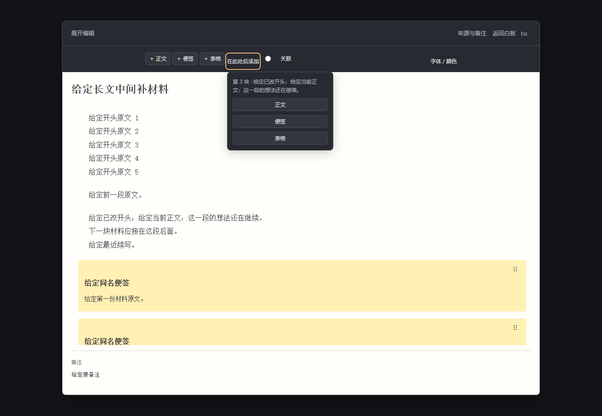
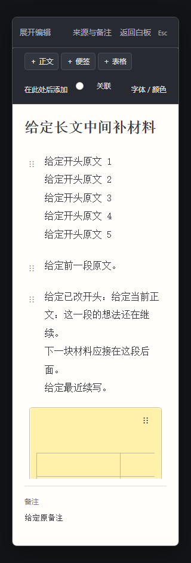

# 把材料接在一段后面

这份说明对应[PR #36 的候选源码](https://github.com/Yueyue673/creative-whiteboard/pull/36)，尚未合并或部署。默认下载版本与其他候选见[版本说明](status.md)。

写到一半，想把一张材料表接在刚写的那段后面，可以直接选定位置再添加。原来的「＋ 正文」「＋ 便签」「＋ 表格」仍然追加到整篇末尾。

## 选定原来的一段

展开长文，点一下想接续的正文段落，或文中的便签、表格。「在此处后添加」会启用；还没选内容时，这个入口保留在原位置，呈灰色。

打开入口后，先看菜单里的块位置和原文开头，确认选中的是想接续的那一块。同名材料也可以靠这里核对。

## 放入新材料

在菜单里选「正文」「便签」或「表格」。新内容接在选中的整块后面，并进入新内容对应的编辑字段；原段落和后面的内容保留。

这里选的是整块之后的位置，不会从正文光标处把一句话切开。如果暂时不添加，按 Esc 收起菜单即可。

## 接着写，或撤销这次插入

继续在新内容里输入，也可以点回原段落续写。下面是320px窄窗里，原段落后刚加入的空表格；同一入口会按窗口宽度排列。

需要撤回整次插入时，返回白板后按 Ctrl＋Z。在文字字段里输入后，Ctrl＋Z 仍按字段原有的文字编辑处理。写完可返回白板继续编排，保存后重新打开，新内容仍在对应位置。

---

两张图来自独立合成作品的原界面，未经替换或重画。已核对1360/320浏览器任务及对应准确CI；窄窗截图不代表实体手机、平板、IME或长期使用体验验收。源码与截图范围见[截图说明](screenshots/README.md#长文段后添加候选)。
