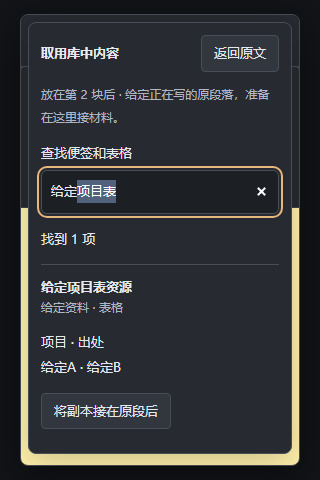
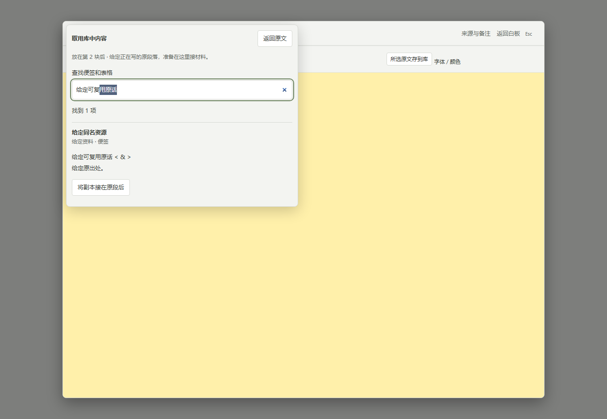

# 把已存内容接到长文原段后

展开长文，先点正在写的段落或材料，再打开“在此处后添加”→“从内容库取用…”。

1. 按原话、名称或文件夹查找便签、表格；当前候选也能[从组合中挑一块](document-library-pieces.md)。先读结果中的原文或表格预览，区分同名内容。
2. 核对上方“放在第几块后”，再点“将副本接在原段后”。库中原件保留，长文里的副本继续沿用原件关联。
3. 回原段落继续写；也可以先“返回原文”或按 Escape 取消，保留原输入和选区。

结构撤销沿用原白板历史：明确返回画布后，可撤销或重做刚接入的副本。文字输入仍用原生文字撤销，输入形成的历史检查点也保持。

库中原件若在选择期间变化，需要重新确认新内容；读取失败可以重试或返回原文。取消后的迟到读取不会重开选择或打断接着输入。需要整组连同关系一起复用时，仍按原内容库路径放到白板；取用单块副本保留库中原组合与其他连线。

本页是尚未部署的[独立候选](https://github.com/Yueyue673/creative-whiteboard/tree/codex/document-library-insert)的真实合成画面。给定原话与表格、同名控制、宽窄窗口及矮窗搜索、取消原字段、续写与两种撤销、保存后新工作台读回已在本机核对；403、取消后迟到、原件变化、目标失效及等待期间重复点击分别用隔离条件核对。源码 CI 结果见对应草稿。

当前证明只覆盖给定单块便签、普通表格和受控条件，不能代表所有嵌套材料、真实网络原因、实体设备、输入法、真人理解或长期体验；未启动服务器核验、部署或私人安装。
