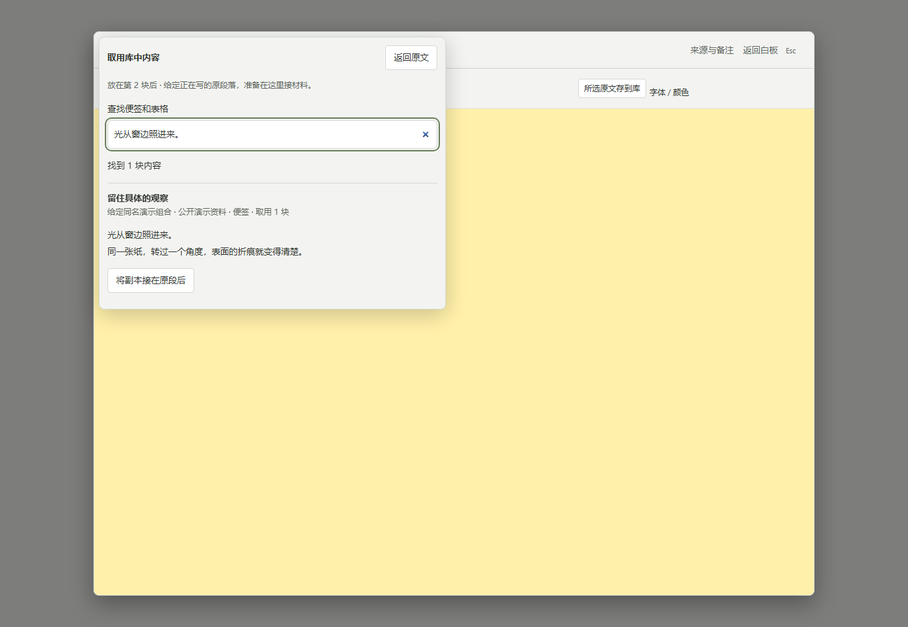
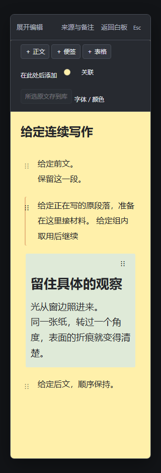

# 从已存组合里取一块，接在长文原段后

一组观察、问题和表格已经存到库里，写长文时只需要其中的一块。展开长文，先点原段落，再打开“在此处后添加”→“从内容库取用…”。

1. 按组合名称、文件夹或具体原话查找。结果显示具体块的标题、所属组合和文件夹；表格同时显示实际行数。
2. 同名内容先读预览，核对“放在第几块后”，再点“将副本接在原段后”。每次取用一块，原组合和其他块、连线仍留在库中。
3. 回原段落继续写，也可以先“返回原文”或按 Escape 取消。结构与文字撤销仍沿用原白板和输入框的规则。

预览用于辨认内容，长文字会标省略号。需要整组和连线一起复用时，继续从原内容库把整组放到白板。本入口不把分组、图形或带块内自连线的内容当成无损单块；无法按编号准确对应时不会猜选。

取用前重新核对库中原件。选中的块已改变或移除，需要重新选择；读取期间取消可回原文，迟到结果不代替后续输入。[单块资源取用及返回步骤](document-library-insert.md)也继续可用。

本页使用仓库公开演示例子的四块内容、三条连线及同名控制，截图来自原程序的隔离源任务。给定宽窄、矮窗搜索、非首项同名目标、取消原字段、原文与表格、原件定位、两种撤销和保存新工作台读回在本机核对；选中块变动、移除、受控重复编号响应和块内自连线分别核对。原单块取用及读取保护按受影响路径回归。

本项仍是尚未部署的[独立候选](https://github.com/Yueyue673/creative-whiteboard/tree/codex/document-library-pieces)，准确源码 CI 结果在对应草稿记录。此证明不涵盖所有嵌套材料、密集资源库、真实网络原因、实体设备、输入法、真人理解或长期体验；未启动作者服务器核验、部署或私人安装。
