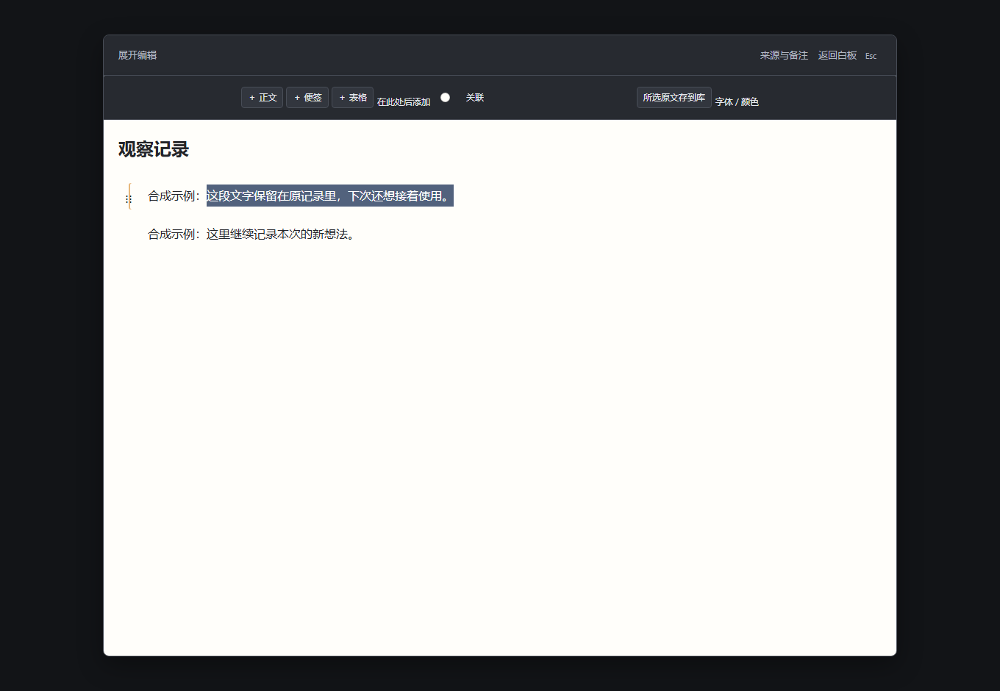
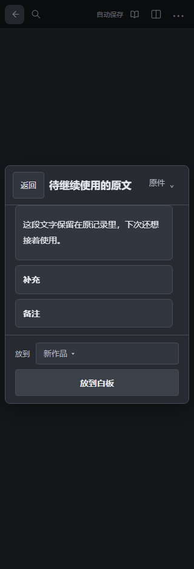

# 在长文里留下一段原话，换份作品接着用

这份操作示例对应[独立源码候选 PR #41](https://github.com/Yueyue673/creative-whiteboard/pull/41)，尚未合入默认 main 或部署网站。截图使用公开合成内容；正常使用入口见[仓库首页](../README.md)。

先打开一份长文，右键选择“展开编辑”。在**正文段落**里选中要留下的原话，上方“所选原文存到库”会启用。本例只选句子，前面的“合成示例：”和下面另一段继续留在原文里。

点“所选原文存到库”，先核对显示的片段。名称可以留空，也可以改成方便以后找到的名称；选择存放位置后点“保存到内容库”。保存后按“继续写作”回到原输入。若暂时不收录，点“取消”，原选区仍保留。

下次在另一份作品中打开内容库，找到这张便签并打开预览。确认“放到”指向想用的作品，再点“放到白板”。

放到白板上的副本可以直接编辑、补充。原长文和库里的片段各自保留，不会因修改新作品而一同改写。

这个入口只取展开长文**正文段落的所选文字**及完整选中的现有固定关联，不收集文中表格、图片或附件。选中标题、文中便签或表格文字时，入口不会启用；较长片段沿用原有长度限制。窄窗的工具条会固定多一行。

截图来自准确源码 dd7e0ba 的1360px与320px桌面合成窗口，未裁切或改画；实体手机、输入法和长期体验另验。版本、验证范围和限制见[状态说明](status.md#candidate-document-selection-text)。
