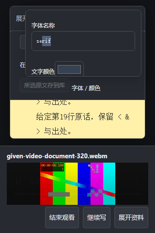
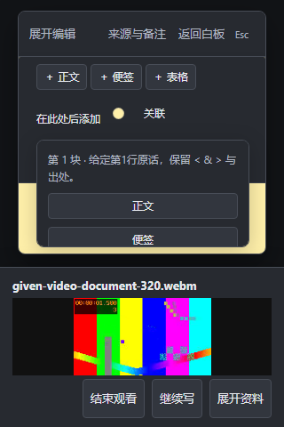

# 在长文里调字体、接材料和滚动阅读

展开长文后，仍使用原来的“字体 / 颜色”和“在此处后添加”。弹出的面板留在当前纸面内，空间不足时会换到更宽裕的一侧；操作较多时，可以在面板内滚动。

1. 打开“字体 / 颜色”，在原字段输入字体名称。改变窗口尺寸时，当前字段和选区保留在可见范围内。
2. 关闭面板，回正文继续写。需要接入材料时，先点原段落或原材料，再打开“在此处后添加”，核对面板显示的块位置。
3. 选择原来的正文、便签或表格按钮。新内容接在所选块后，随后可以继续填写，再回原段落续写。

在视频或音频旁展开长文时，可以用鼠标滚轮继续阅读正文和文中材料；面板内的滚动也仍作用于当前面板。正文不会把滚轮困在没有可滚距离的内部容器里。

文字输入沿用原文字撤销；明确返回画布后，结构撤销沿用原项目的操作历史。最近输入也会形成原有历史检查点，撤销不跳过它。

本页是尚未部署的[独立候选](https://github.com/Yueyue673/creative-whiteboard/tree/codex/document-tool-panels)的原生合成画面，全部文字与图案视频均为给定验收材料。宽窄窗口、变矮时的菜单输入、真实鼠标滚动与可见点、样式修改、段后添加、两种撤销及保存读回已在本机核对；源码 CI 结果在对应草稿记录。没有验证实体设备、输入法、系统原生色盘、真人理解或长期舒适。
