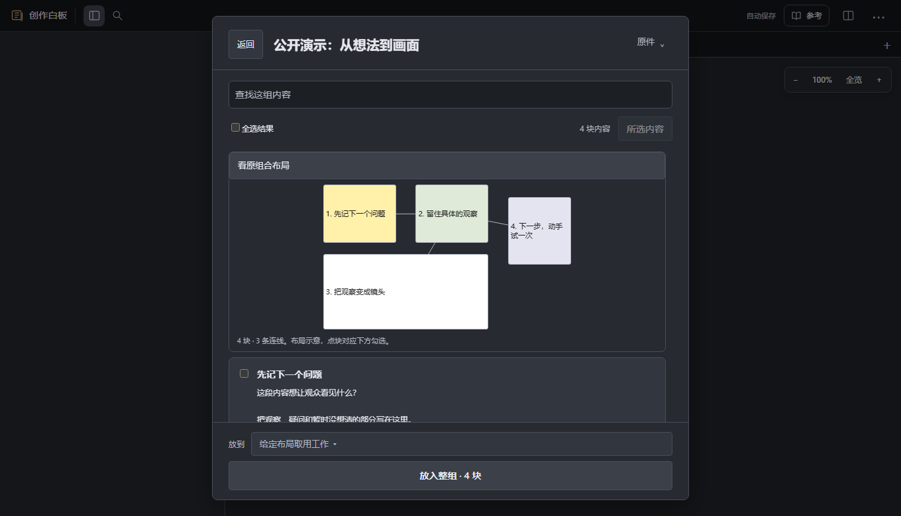
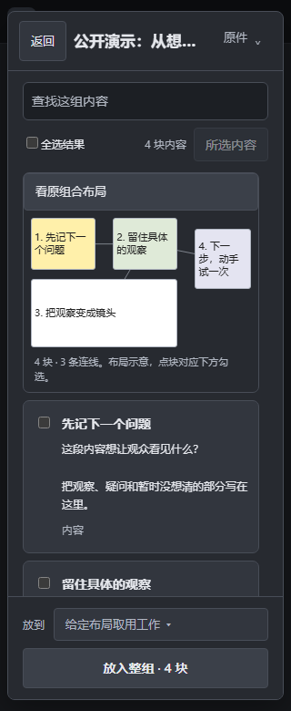

# 在取用前看原组合布局

已经存下的便签和表格，在内容库预览里仍按原来的列表阅读。需要辨认它们在一组内容中的位置时，展开“看原组合布局”。

1. 看各块的相对位置和标题。数字对应下方列表中的原块，不会重新排序。
2. 直接点布局里的块，或用键盘选择；下方原复选框同步勾选。继续按原文查找，布局仍保留位置，当前结果之外的块变淡。
3. 核对原来的“放入所选”数量与目标白板，再取用副本。只想看看，点“返回”即可。

这是布局示意，完整文字仍在下方。较小或重叠的块从原列表勾选；组合较大、含其他形状或坐标不完整时，继续使用原列表预览。原件、手动位置和尺寸、其他块及连线保留，布局不会改写它们。矮窗沿原阅读区滚动，原“返回”和放入动作仍可使用。

需要把一块接到长文原段后，可以继续[从内容库取用组内便签或表格](document-library-pieces.md)。本布局视图用于内容库里的组合辨认，沿用原来的取用操作。

本页画面来自仓库公开的四块内容、三条连线示例，实际源任务使用隔离数据。本机核对1360/320、780→480、鼠标与键盘、过滤和取消、后续窗口保护、准确副本、撤销重做、保存及新工作台读回；较小/重叠与无效坐标分别核对。原组合预览的整组/所选取用、原件编辑、读取失败重试和独立入口作受影响回归。

本项是尚未部署的[独立候选](https://github.com/Yueyue673/creative-whiteboard/tree/codex/library-spatial-preview)，准确源码CI结果在对应草稿记录。原型与源码验证分别保留；没有用布局图代替完整内容渲染，也未宣称所有组合、实体设备、真人理解或长期体验已经验收。未启动作者服务器核验、生产切换或私人安装。
