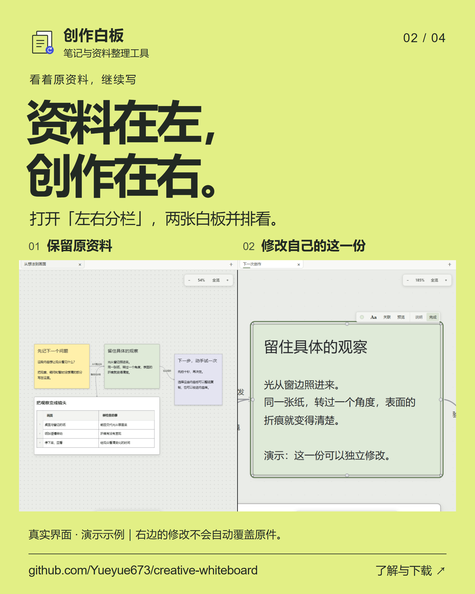
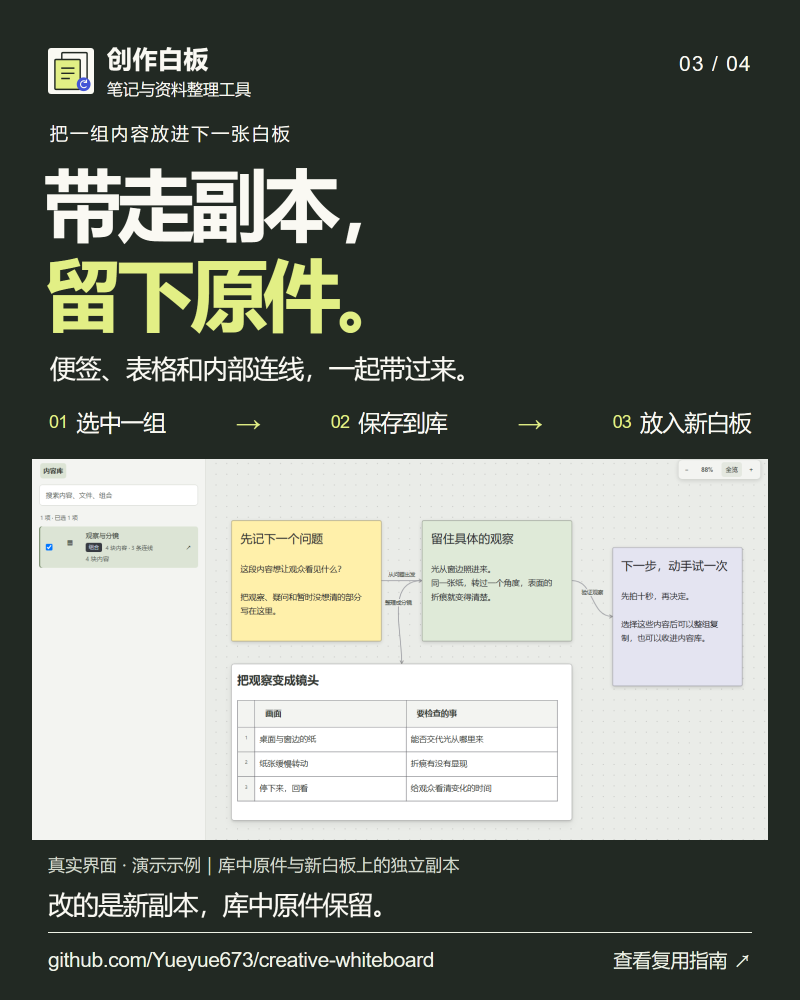
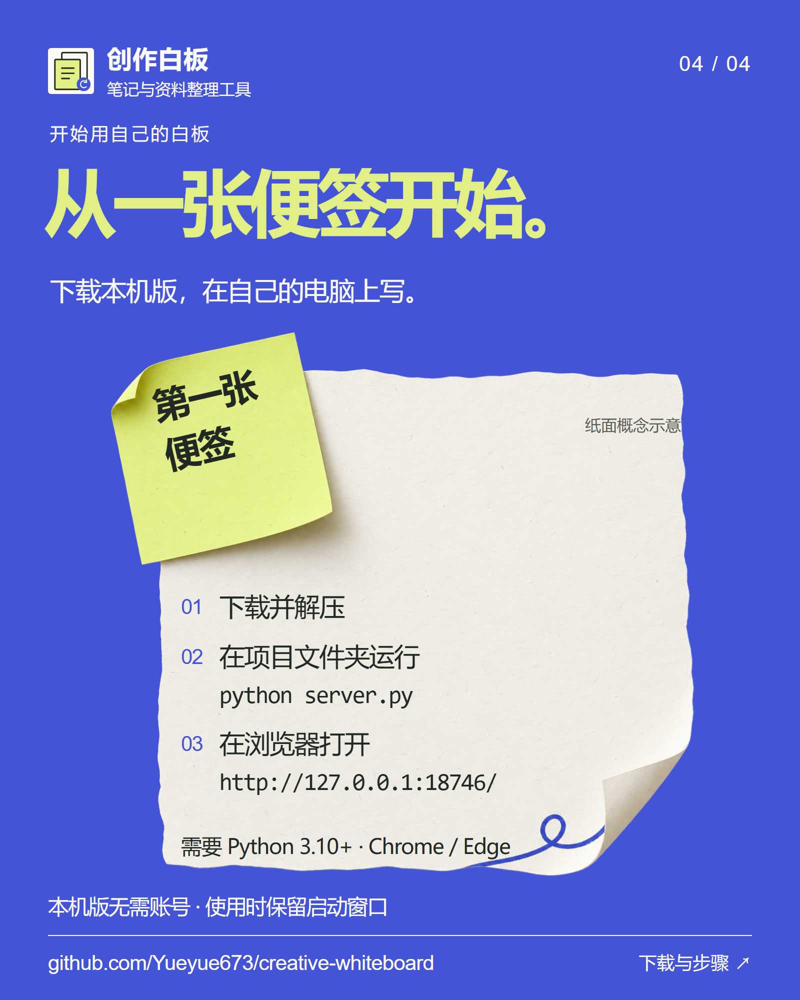

# 创作白板 · 四张介绍海报

**这一组，下次接着用。** 便签、表格和连线整组留下，在新白板取出副本继续创作。四张海报围绕同一件事，从用途、场景、操作讲到开始方式。

每张均为独立的 **1600 × 2000 PNG，4:5 竖版**，可以单独保存和发布。图片中的网址通向本仓库；下载的是需要 Python 3.10+ 与 Chrome / Edge 的本机版。没有加入未验证的二维码或在线体验入口。

[回到项目首页](../../README.md) · [下载本机版](https://github.com/Yueyue673/creative-whiteboard/archive/refs/heads/main.zip) · [第一次使用](../start.md)

## 01 · 这一组，下次接着用

用于第一次介绍项目：把整理好的便签、表格和连线留下，下一次取出副本继续。纸面插画为**概念示意**，不是软件界面。

[保存高清图片](01-reuse.png)

## 02 · 资料在左，创作在右

用于说明分栏场景：左边看原资料，右边编辑自己的副本。画面是原本机版公开示例的真实截图局部；没有改动界面文字或添加不存在的按钮。

[保存高清图片](02-compare.png)

## 03 · 带走副本，留下原件

用于解释整组复用：选中内容、保存到库、放到新白板。示例中四块内容与三条内部连线一起带来；修改新副本不会自动覆盖库中原件。

[保存高清图片](03-library.png)

## 04 · 从一张便签开始

用于引导下载和启动：先解压，再在项目文件夹运行程序，最后打开本机地址。列出所需 Python 和浏览器；“无需账号”仅指本机版。纸面插画为概念示意。

[保存高清图片](04-start.png)

## 素材与事实来源

- **产品和开始方式：** [首页](../../README.md)、[第一次使用](../start.md)、[版本限制](../status.md)。默认分支是本机版，账号版仍在开发分支，不能把服务器部署能力当作 ZIP 下载后就有的功能。
- **已核对的场景：** [复用指南](../reuse.md)、[使用说明](../usage.md)与[截图来源](../screenshots/README.md)。案例为仓库公开的[演示示例](../../examples/getting-started.json)，不是私人作品。原图保留，海报仅通过排版窗口裁切、缩放显示。
- **许可证与署名：** [MIT](../../LICENSE) · Creative Whiteboard contributors。现有[标志](../brand/mark.svg)原样保留；没有借用参考项目的品牌素材。
- **展示顺序参考：** [Voyager](https://github.com/voyager-crew/voyager)的用途、场景、产品展示与开始入口安排。这里的文案、配色和纸面创意属于创作白板，没有引用人物评价或背书。

## 维护设计文件

- [可编辑排版](design/index.html)：HTML/CSS，包含四张海报和首页横版封面。文字、网址和命令由排版工具绘制，真实界面直接引用公开截图。
- [渲染脚本](design/render.cjs)：使用本机安装的 Playwright 与 Chromium，逐张导出图片。运行时只读取本仓库素材，不需要启动产品或接触用户数据。传入 Chromium 路径即可；第二个可选参数是仓库外的检查结果目录。
- [生成记录与完整提示词](sources/prompts.json)：两幅纸面插画使用内置 imagegen 制作，透明插画的 alpha 保留。插画文件在 `illustrations/`；没有把生成界面冒充实际产品。
- [首页横版封面](../brand/reuse-paper-cover.png)：1600 × 800，单独适配 README，未把四张竖版海报堆到首页。

排版使用系统中文字体，不分发字体文件。重新渲染时，准备 Microsoft YaHei、PingFang SC 或 Noto Sans CJK SC，并逐张检查中文换行、手机尺寸、网址对比和图片裁切。不要把正在开发或尚未核对的功能补进宣传文案。
