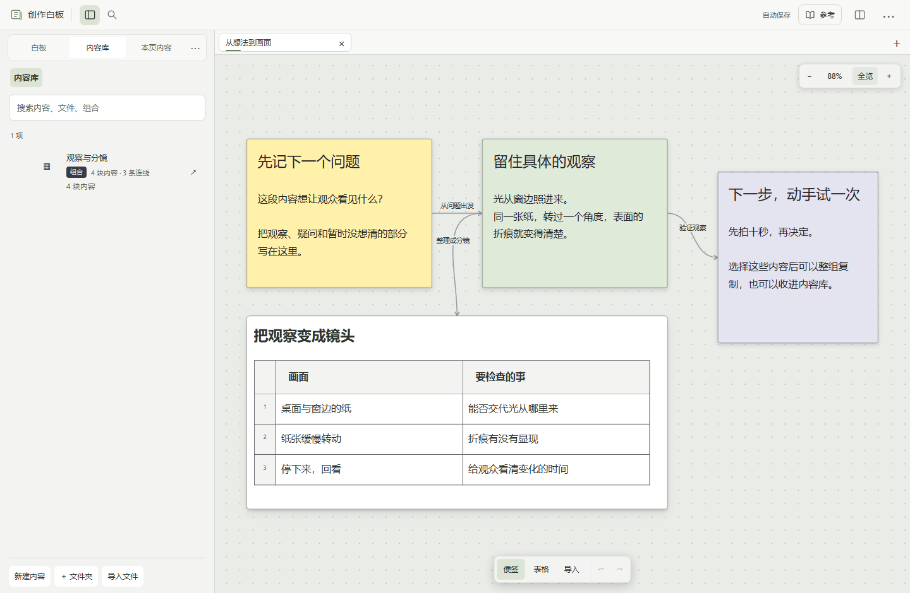
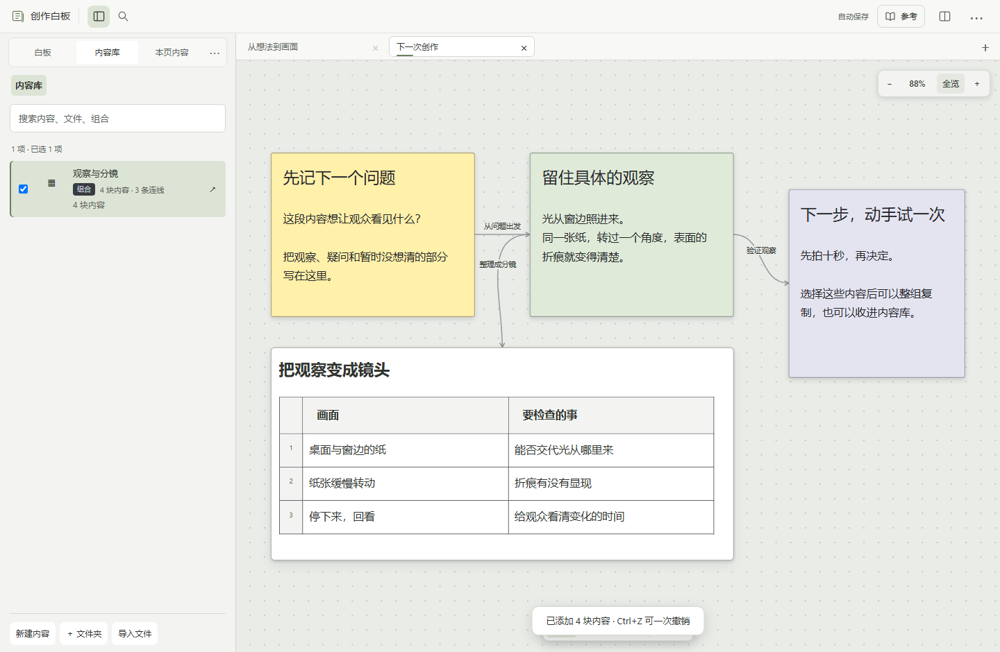
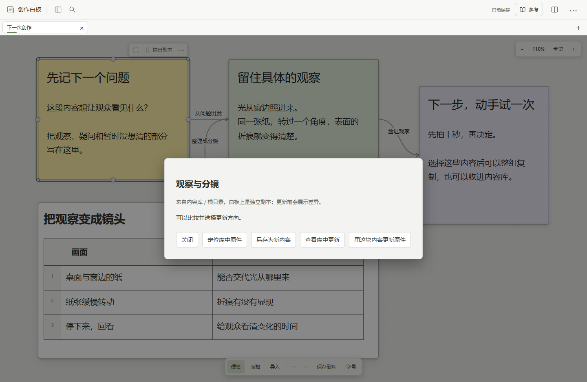

# 把做过的内容，用在下一次

这次为一段画面整理了问题、观察和镜头表，下次还想沿用这组结构。把便签、表格和内部连线存进内容库，再放到新白板，得到可以独立修改的副本。原白板与库中原件保留。

[返回首页](../README.md) · [第一次使用](start.md) · [完整使用说明](usage.md)

下面的图片均为**演示示例**。启动白板后，把项目中的 [examples/getting-started.json](../examples/getting-started.json) 拖到画布，就能用同一份材料跟着操作。

## 1. 把选中的内容存成资源

在白板上多选要留下的便签、表格或其他内容，点「保存到库」，或按 **Ctrl＋Shift＋L**。填写名称，选择存放位置，点「收进内容库」。

可以只留一块，也可以留一整组。组合会保存选中内容之间的内部连线；原白板上的内容保留。

## 2. 在另一张白板继续用

从标签栏的「＋」打开或新建另一张白板。展开左侧「内容库」，找到刚保存的资源，拖到白板上；也可以选中资源，按 **Ctrl＋Enter** 整体放入当前白板。

得到的是独立副本。你可以重新摆放、修改文字和表格、连接新的内容。组合也可以先双击预览，只挑其中几块来用。底部的“放入整组”会在勾选后变成“放入所选”，并显示实际放入数量；分组会带上其中的内容。返回和放入保持可见，列表可以独立滚动。

放入后想接着写，点选中数量（如“2项”），按标题打开对应内容。仍在原编辑器里写，返回后可恢复原来的视角。窄窗口有放入内容在屏幕外时，这个列表会自动展开；收起后仍能点数量找回。取消选择或改选其他内容，列表就跟着结束或变化。

## 3. 需要时，再与原件对照

在副本上右键，选择「来源与版本…」。可以定位库中原件、查看库中更新，或用当前内容更新原件。

更新前会展示差异，由你选择方向和要更新的字段。白板上的位置与尺寸保留，其他副本不会跟着自动改变。不需要合回去时，就让这份副本继续独立使用。

## 内容留下，修改仍由你决定

- 收进库不移走原白板内容；取出使用不消耗库中原件。
- 便签和表格以内容副本复用；媒体继续引用原文件。修改分类不会搬动硬盘上的文件。
- 白板上的删除与更新可以用 **Ctrl＋Z** 撤销。库中原件的更新在内容库撤销。
- 备份时保留 `data/`，以及引用在其他目录的原文件。历史记录不能代替独立备份。

这些画面来自原工作台，演示内容为仓库自带的 [示例白板](../examples/getting-started.json)。[开始使用](../README.md#三步开始)
