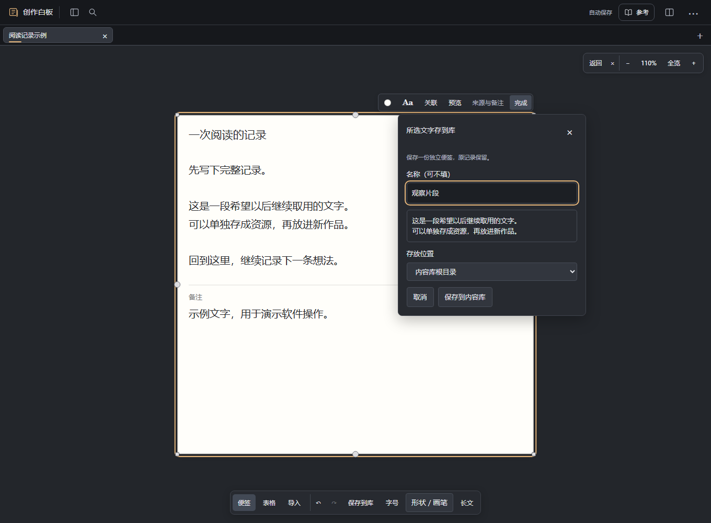
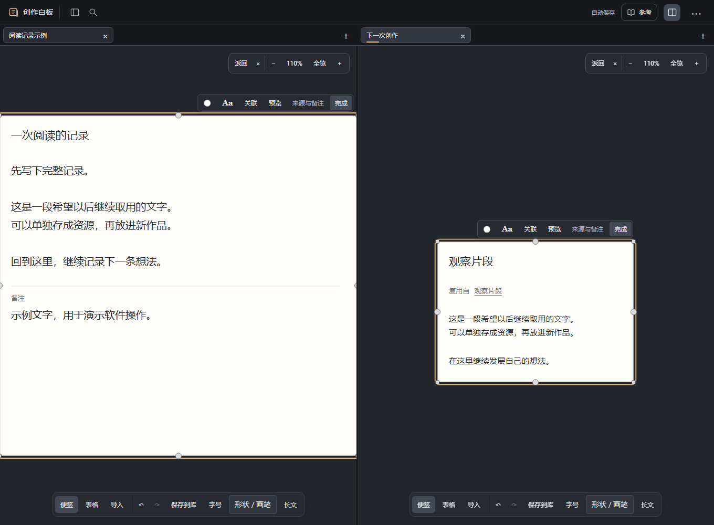
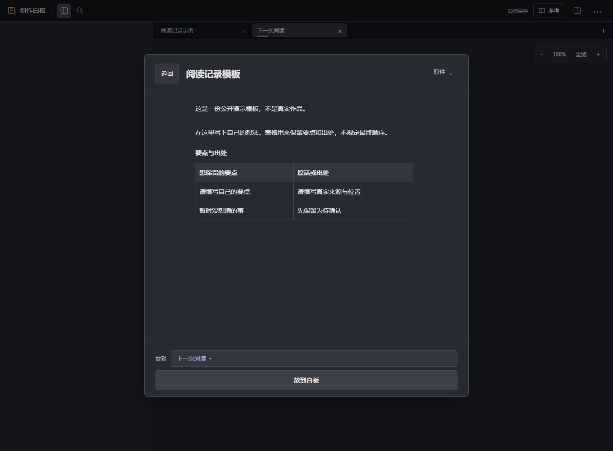
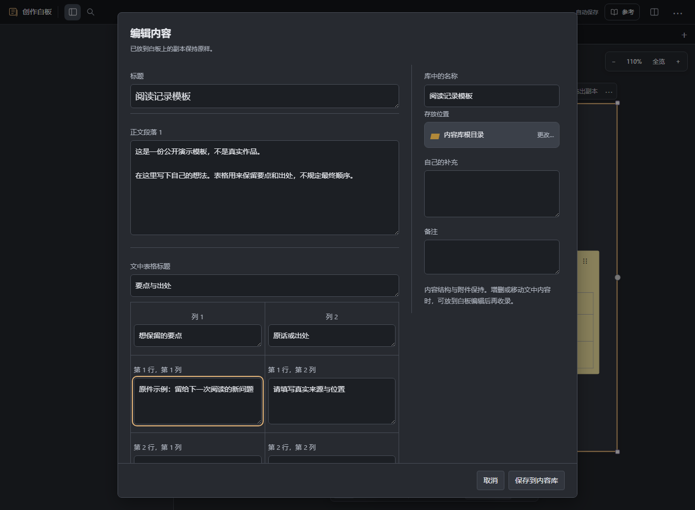

# 把做过的内容，用在下一次

这次为一段画面整理了问题、观察和镜头表，下次还想沿用这组结构。把便签、表格和内部连线存进内容库，再放到新白板，得到可以独立修改的副本。原白板与库中原件保留。

[返回首页](../README.md) · [第一次使用](start.md) · [完整使用说明](usage.md)

下面的图片均为**演示示例**。启动白板后，把项目中的 [examples/getting-started.json](../examples/getting-started.json) 拖到画布，就能用同一份材料跟着操作。

## 1. 把选中的内容存成资源

在白板上多选要留下的便签、表格或其他内容，点「保存到库」，或按 **Ctrl＋Shift＋L**。填写名称，选择存放位置，点「收进内容库」。

可以只留一块，也可以留一整组。组合会保存选中内容之间的内部连线；原白板上的内容保留。

## 2. 在另一张白板继续用

从标签栏的「＋」打开或新建另一张白板。展开左侧「内容库」，找到刚保存的资源，拖到白板上；也可以选中资源，按 **Ctrl＋Enter** 整体放入当前白板。

得到的是独立副本。你可以重新摆放、修改文字和表格、连接新的内容。组合也可以先双击预览，只挑其中几块来用。底部的“放入整组”会在勾选后变成“放入所选”，并显示实际放入数量；分组会带上其中的内容。返回和放入保持可见，列表可以独立滚动。

放入后想接着写，点选中数量（如“2项”），按标题打开对应内容。仍在原编辑器里写，返回后可恢复原来的视角。窄窗口有放入内容在屏幕外时，这个列表会自动展开；收起后仍能点数量找回。取消选择或改选其他内容，列表就跟着结束或变化。

## 3. 需要时，再与原件对照

在副本上右键，选择「来源与版本…」。可以定位库中原件、查看库中更新，或用当前内容更新原件。

更新前会展示差异，由你选择方向和要更新的字段。白板上的位置与尺寸保留，其他副本不会跟着自动改变。不需要合回去时，就让这份副本继续独立使用。

## 内容留下，修改仍由你决定

- 收进库不移走原白板内容；取出使用不消耗库中原件。
- 便签和表格以内容副本复用；媒体继续引用原文件。修改分类不会搬动硬盘上的文件。
- 白板上的删除与更新可以用 **Ctrl＋Z** 撤销。库中原件的更新在内容库撤销。
- 备份时保留 `data/`，以及引用在其他目录的原文件。历史记录不能代替独立备份。

这些画面来自原工作台，演示内容为仓库自带的 [示例白板](../examples/getting-started.json)。[开始使用](../README.md#三步开始)

## 独立候选：只留一段文字，下次接着写

本段展示[候选源码 bfaadf2](https://github.com/Yueyue673/creative-whiteboard/commit/bfaadf2c964eece50d88af32177261c97fac507f)的普通便签文字片段入口，尚未合入默认 main 或部署网站。[文字片段示例](../examples/selection-text-candidate.json)只含一张普通便签和演示文字，可在本指南所在候选分支跟着操作。

**打开原记录。** 新建空白板，点“添加文件”，选择示例 JSON。编辑“一次阅读的记录”，选中中间的“这是一段希望以后继续取用的文字。”和“可以单独存成资源，再放进新作品。”两句。

**只收这两句。** 点便签工具条的 **Aa**，选择“所选文字存到库”。核对原文，名称填“观察片段”，选择存放位置，点“保存到内容库”。保存成功后点“继续写作”，回到原字段与选区。整段原记录保留，不必先复制再粘贴到库。

**在下一份作品继续写。** 从标签栏“＋”新建“下一次创作”。打开内容库，搜索“观察片段”，预览后点“放到白板”。编辑这份副本，加入自己的想法。图中用原工作台双栏同时查看：左侧仍是完整原记录，右侧只有取出的片段和新写的一句；库中原件仍保留保存时的两句。

这是一份独立的文字资源，修改它不会自动更新整张原记录。此入口保存普通便签正文中的所选文字；附件、文中表格和混合材料可按上方的整块或整组收录方式保留。

## 独立候选：维护一份长文资源

本段展示[候选源码 f070354](https://github.com/Yueyue673/creative-whiteboard/commit/f07035417ac1efeeede2b1cfe33690890ddddb7f)中的库内长文阅读与维护，尚未合入默认 main 或部署网站。本指南所在候选分支带有[阅读记录示例](../examples/reading-resource-candidate.json)，仅含演示占位文字、表格和说明便签。

**先收录。** 新建空白板，点“添加文件”选择这个 JSON。只选中长文“阅读记录模板”，右键选择“收进内容库”。这里只收录长文；说明便签和外部连线留在示例白板上。

**先读，再复用。** 从标签栏“＋”新建“下一次阅读”，在内容库找到标为“长文”的“阅读记录模板”，双击预览。正文和“要点与出处”表格都能直接阅读。点“放到白板”得到独立副本，再展开编辑，写自己的这一份。

**维护供下次使用的原件。** 再从内容库打开这份资源，展开“原件”，点“编辑原件”。修改段落、文中表格列名或材料文字，点“保存到内容库”。图中把一个要点改为“原件示例：留给下一次阅读的新问题”；已经取出的副本仍保留自己的内容。

以后重新取出的副本使用库中的当前版本。需要更新旧副本时，从它的“来源与版本…”比较并选择要接收的字段。发生正文与文中材料冲突时，选择保留整项版本，不会逐格自动合并。增删或移动文中内容，继续在原白板编辑。
