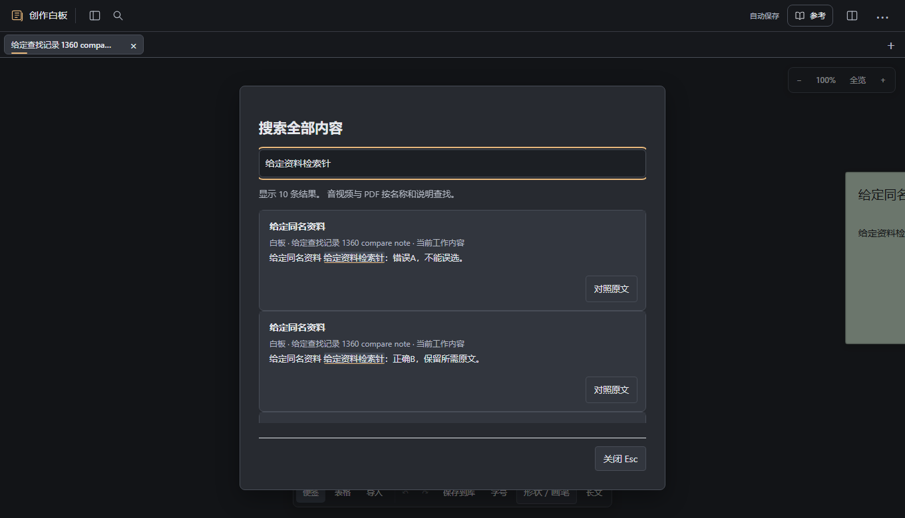
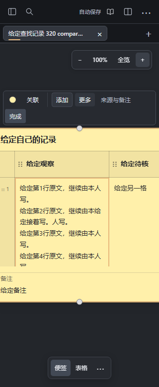

# 查到资料后，回原字段继续写

在画布中原位编辑便签或表格单元格时，打开原“搜索全部内容”（Ctrl+K），查找需要对照的资料。结果原来的标题/摘要按钮仍用于定位内容；旁边的“对照原文”会把所选白板原文放进原只读资料栏。读完点“返回记录”，回到刚才同一个输入框、选区和滚动位置，继续写自己的内容。

较窄窗口里资料栏占据阅读区，返回后继续原字段；宽窗沿用原资料栏布局。搜索对照不把资料写成作者正文，也不会插入引用标记。资料位置按准确白板ID与内容ID对应，同名内容不会按标题猜测；跨白板先读取所选原文，失败或无法唯一对应时保留搜索与原记录。

等待读取时可以取消、改查找或继续原输入，迟到的结果会放弃打开；原搜索关闭事件完成后才打开资料栏，保留原窗口清理行为。已经离开或改变的写作上下文不会被重新拉回。资料栏之后仍沿用原只读阅读、更新与返回行为。

本范围支持画布原位的便签和表格字段；从其他位置查找时沿原定位流程。它没有新增展开长文中的搜索对照流程，也不读取音视频画面或转写内容。

源码本机合成任务完成六例（320/1360的原定位、便签对照、表格单元格对照），核对原字段身份、反向选区、滚动/视角/模型、原生输入与撤销重做、保存及新工作台读回。另有八例核对跨白板同名同ID、重复请求抑制、取消后续写、改查找、后开窗口、读取失败重试和缺失/歧义拒绝；晚回执检查等待原方法真实结束后再比对。原嵌套内容搜索和引用返回两项受影响任务完成。

早期原型与源码分开。源码首个完整任务暴露了搜索关闭事件清理新资料栏的问题，已修复并保留失败证据。截图全部来自本机给定的合成资料，未使用作者创作。当前准确源码CI尚未运行，未合并、部署、服务器验收或私人安装；实体设备、IME、真人理解与长期使用未验。
