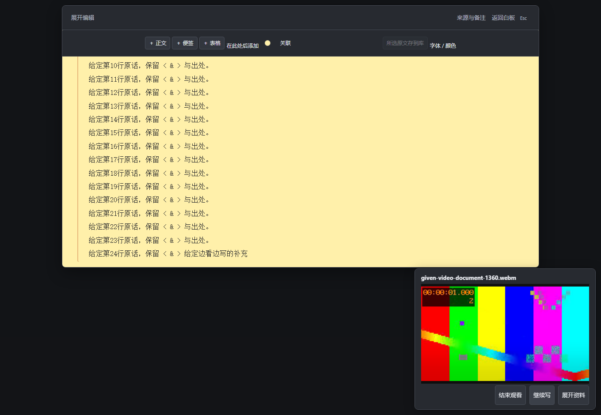
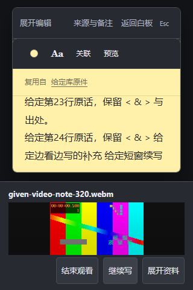

# 看视频时回原文接着写

查资料时，可以把内容库中的视频留在一旁，再回到当前白板的原位置继续写。

1. 在内容库打开视频预览，用原播放器开始播放。
2. 点“边看边写”，再点“继续写”。视频留在一旁，原便签或长文仍可输入；原字段和选区保留。
3. 需要细看时点“展开资料”，看完再回到“边看边写”。结束时点“结束观看”，返回正在写的原文。

可以在视频原控件中暂停和定位，再点“继续写”回原字段。展开、返回和继续写会使用同一播放器；不会另外导入一份视频。结束观看会暂停资料播放器，原文仍留在当前白板。

## 窗口变矮时

视频区域随窗口高度缩小，便签和长文仍在上方滚动写作。视频里的小字可能看不清，可以点“展开资料”查看。

音频仍使用原来的“边听边写”入口。

本指南对应独立候选源码 [c5ae634](https://github.com/Yueyue673/creative-whiteboard/commit/c5ae634afbf17ab40e44903e12e078c4556b6ff5)，尚未部署到网站。画面是该源码原生界面的未编辑截图，全部文字和无声 VP9 图案视频均为合成验收材料。宽窄便签、含文中材料的长文、短窗实际输入/撤销重做和光标可见性、关闭返回与保存读回已在本机核对；不代表实体手机、输入法、所有编解码或长期体验已验收。源码 CI 结果见 [草稿 PR #44](https://github.com/Yueyue673/creative-whiteboard/pull/44)。
